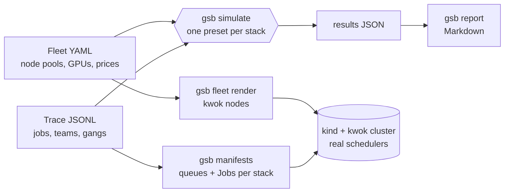

# k8s-gpu-scheduler-benchmark

**Which Kubernetes GPU scheduler should you run?** This project answers that with numbers. It replays the same AI
workload trace (multi-node training gangs, fine-tunes, inference services, notebooks) against each scheduling stack
on a simulated GPU fleet, and measures what platform teams argue about: GPU utilisation, fragmentation, queue wait,
fairness between teams, and cost. **No GPUs are needed.**

Stacks: the default kube-scheduler, [Kueue](https://github.com/kubernetes-sigs/kueue),
[Volcano](https://github.com/volcano-sh/volcano) and [KAI Scheduler](https://github.com/kai-scheduler/KAI-Scheduler),
the scheduler at the core of the newly open-sourced [NVIDIA Run:ai](https://github.com/dsx-ai-factory/run-ai).

## First results

A mixed 256-GPU fleet (16 x 8 H100, 16 x 4 L40S, 32 x 2 L4), 131 jobs from three teams over 8 hours, about 107% of
capacity. Reference simulation; see [what that means](#how-it-works-and-what-it-is-not).

| | default | Kueue | Volcano | KAI |
|---|---|---|---|---|
| Time to finish all work | 26.0 h | 26.9 h | **19.9 h** | **19.9 h** |
| Useful GPU utilisation | 32.9% | 32.0% | 43.0% | **44.4%** |
| Queue wait p95 | 698 min | 596 min | 183 min | **122 min** |
| GPUs held idle by half-placed gangs | 319 GPU-h | **0** | **0** | **0** |
| Work lost to preemption | **0** | 11 GPU-h | **0** | 72 GPU-h |
| Cost per useful GPU-hour | $5.09 | $5.25 | **$3.90** | **$3.90** |

What the numbers say:

- **Gang scheduling plus bin-packing is worth 23% of the GPU bill here.** Volcano and KAI finish the same work in
  19.9 h instead of 26 h. The default scheduler places training pods one at a time, so half-placed gangs hold
  319 GPU-hours doing nothing, and spreading pods across nodes leaves no whole node free for the next 8-GPU replica.
- **Quotas buy guarantees, not throughput.** On the small 32-GPU lab ([full results](results/README.md)), each team's
  quota (10 GPUs) is smaller than a 16-GPU training gang. There the default scheduler finishes first (10.0 h vs 12.1 to 15.6 h
  for the quota stacks), but Kueue and KAI keep notebook waits at 0 min p95 (vs 31 min) and treat teams more evenly.
- **Reclaim has a price.** KAI gives teams back their quota by preempting borrowers, which cost 72 GPU-hours of lost
  training progress even with 30-minute checkpoints.

Full tables, per-team waits and costs: [results/README.md](results/README.md). These are one seed per fleet; treat
them as a worked example, not a verdict.

## Quick start

```bash
pip install git+https://github.com/sunilmehta-si/k8s-gpu-scheduler-benchmark
git clone https://github.com/sunilmehta-si/k8s-gpu-scheduler-benchmark && cd k8s-gpu-scheduler-benchmark

gsb fleet summary fleets/mixed-256.yaml
gsb trace generate --fleet fleets/mixed-256.yaml --hours 8 --rate 16 --seed 42 -o my-trace.jsonl
gsb trace stats my-trace.jsonl --fleet fleets/mixed-256.yaml
gsb simulate --fleet fleets/mixed-256.yaml --trace my-trace.jsonl -o results.json
gsb report results.json
```

Bring your own fleet (node pools, GPU models, prices) and your own trace (one JSON object per job; see
[`trace.py`](gpu_sched_bench/trace.py)).

## Run it on a real cluster (manifests ready, replay next)

```bash
gsb fleet render fleets/lab-32.yaml > nodes.yaml          # kwok fake GPU nodes
gsb manifests --stack kai --fleet fleets/lab-32.yaml --trace traces/lab-32-8h.jsonl --part setup > setup.yaml
gsb manifests --stack kai --fleet fleets/lab-32.yaml --trace traces/lab-32-8h.jsonl --part jobs --speedup 60 > jobs.yaml
```

Each stack gets its own configuration: Kueue ClusterQueues and LocalQueues, Volcano Queues, KAI hierarchical Queues,
and every trace job as a Job that the stack schedules. Fake pods finish after their trace duration through kwok's
pod-complete stage. A replayer that submits jobs at their arrival times and collects results from the cluster is the
next milestone.

## How it works, and what it is not



`gsb simulate` is a discrete-event **model** of each stack's documented behaviour: gang or pod-by-pod placement,
spread or bin-packing, queue order, quotas, borrowing and reclaim. It is not the schedulers' code, and it models no
hardware effects. Every modelling choice and its source is in [docs/methodology.md](docs/methodology.md), so you can
disagree with a specific one. Cluster runs of the real schedulers are how the model gets checked.

## Status

| Part | State |
|---|---|
| Fleets, traces, generator, kwok node rendering | Done, tested |
| Reference simulator, four stack presets, metrics, reports | Done, tested; results reproduced in CI |
| Manifests for default, Kueue, Volcano and KAI | Done, unit-tested; written to each project's documented API, not yet applied to a cluster |
| Trace replay on kind + kwok with the real schedulers | Next |
| NVIDIA Run:ai full platform, DRA, topology-aware placement | Planned |

## License

[MIT](LICENSE) © Sunil Mehta
