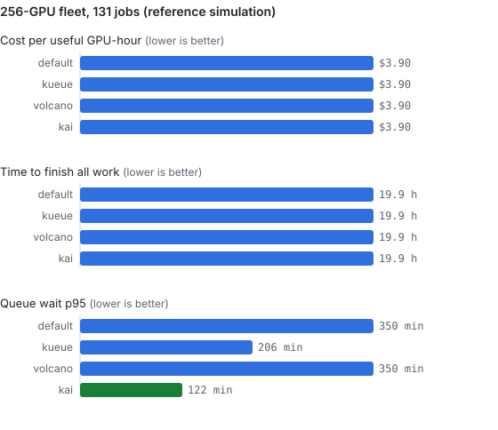
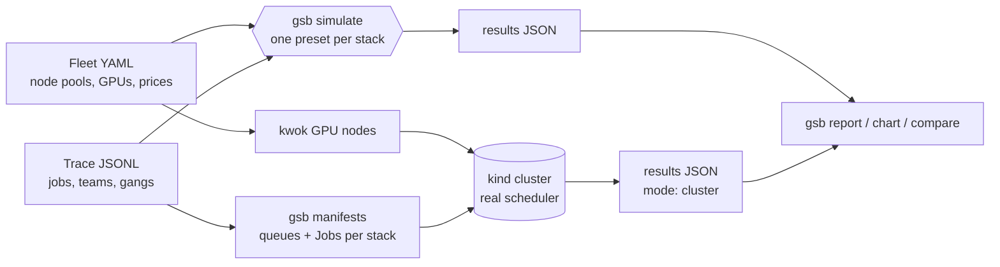

# k8s-gpu-scheduler-benchmark

[](https://github.com/sunilmehta-si/k8s-gpu-scheduler-benchmark/actions/workflows/ci.yml) [](https://github.com/sunilmehta-si/k8s-gpu-scheduler-benchmark/actions/workflows/cluster.yml)

**Which Kubernetes GPU scheduler should you run?** This project answers that with numbers. It replays the same AI
workload trace (multi-node training gangs, fine-tunes, inference services, notebooks) against each scheduling stack
and measures what platform teams argue about: GPU utilisation, fragmentation, queue wait, fairness between teams,
and cost. It does this two ways: a fast reference **simulation**, and **real schedulers** on a kind cluster with
simulated GPU nodes. **No GPUs are needed for either.**

Stacks: the default kube-scheduler, [Kueue](https://github.com/kubernetes-sigs/kueue),
[Volcano](https://github.com/volcano-sh/volcano) and [KAI Scheduler](https://github.com/kai-scheduler/KAI-Scheduler),
the scheduler at the core of the newly open-sourced [NVIDIA Run:ai](https://github.com/dsx-ai-factory/run-ai).

## Results

A mixed 256-GPU fleet (16 x 8 H100, 16 x 4 L40S, 32 x 2 L4), 131 jobs from three teams over 8 hours, about 107% of
capacity. Reference simulation; see [how close the model is](#checked-against-the-real-schedulers).



| | default | Kueue | Volcano | KAI |
|---|---|---|---|---|
| Time to finish all work | 26.0 h | 26.9 h | **19.9 h** | **19.9 h** |
| Useful GPU utilisation | 32.9% | 32.0% | 43.0% | **44.4%** |
| Queue wait p95 | 698 min | 596 min | 183 min | **122 min** |
| GPUs held idle by half-placed gangs | 319 GPU-h | **0** | **0** | **0** |
| Work lost to preemption | **0** | 11 GPU-h | **0** | 72 GPU-h |
| Cost per useful GPU-hour | $5.09 | $5.25 | **$3.90** | **$3.90** |

What the numbers say:

- **Bin-packing is the lever, not gang scheduling.** [`gsb ablate`](#quick-start) switches behaviours on one at a time.
  Gang scheduling alone removes the 319 stranded GPU-hours but makes this trace *slower* (28.1 h), because whole gangs
  wait for room that spreading never leaves. Bin-packing, with or without gangs, cuts it to 19.9 h.
- **Across ten traces, not just one, the bin-packing stacks are about 19% cheaper.** Volcano and KAI average $4.91 per
  useful GPU-hour against $6.08 for the default scheduler, and are the cheapest on 8 of 10 seeds. The default
  scheduler wins on 2, so this is a strong tendency, not a law ([sweep](results/sweep-mixed-256.md)).
- **Preemption protects interactive work.** On the 32-GPU lab ([full results](results/README.md)), every stack that
  preempts by priority keeps notebook waits at 0 min p95; Volcano's default configuration doesn't preempt, and
  notebooks wait 31 min. The price is lost work: KAI's reclaim cost 72 GPU-hours of training progress on the big
  fleet, even with 30-minute checkpoints.

## Checked against the real schedulers

The [cluster workflow](.github/workflows/cluster.yml) installs each real scheduler on a kind cluster with
[kwok](https://kwok.sigs.k8s.io/) GPU nodes, replays a 12-job trace, and compares the result with the model.
First runs ([details](results/cluster/README.md)):

| Stack | Time to finish: model | Real scheduler |
|---|---|---|
| default | 10.6 h | 9.4 h |
| KAI 0.18.5 | 6.9 h | 7.7 h |
| Kueue v0.20.1 | 9.5 h | 7.7 h |
| Volcano v1.16.0 | 6.9 h | **12.8 h** |

The model is within about 11% for the default scheduler and KAI. It underestimates Kueue, and it badly overestimates
Volcano, whose default configuration adds least-requested node scoring, queue caps and an admission gate that the
preset doesn't model. So: use the simulation to reason about behaviours, and cluster runs before choosing a scheduler.
That gap is documented in the [methodology](docs/methodology.md#how-close-is-the-model), not tuned away.

The cluster runs check themselves: every pod's observed runtime is compared with its expected runtime, and the run
fails if they disagree. That check caught a real bug during development, a kwok setting that made every fake pod
finish instantly ([write-up](docs/cluster-runs.md#how-a-run-is-checked)).

## Quick start

```bash
pip install git+https://github.com/sunilmehta-si/k8s-gpu-scheduler-benchmark
git clone https://github.com/sunilmehta-si/k8s-gpu-scheduler-benchmark && cd k8s-gpu-scheduler-benchmark

gsb trace generate --fleet fleets/mixed-256.yaml --hours 8 --rate 16 --seed 42 -o my-trace.jsonl
gsb simulate --fleet fleets/mixed-256.yaml --trace my-trace.jsonl -o results.json
gsb report results.json                                   # Markdown comparison
gsb chart results.json -o results.svg                     # bar charts
gsb sweep --fleet fleets/mixed-256.yaml --seeds 1-10      # mean and spread over ten traces
gsb sweep --fleet fleets/mixed-256.yaml --seeds 1-5 --rates 8,12,16,20   # load curve
gsb ablate --fleet fleets/mixed-256.yaml --trace my-trace.jsonl          # which behaviour causes a gain
```

Bring your own fleet (node pools, GPU models, prices) and trace (one JSON object per job; jobs can require a GPU
model). See [`trace.py`](gpu_sched_bench/trace.py) and [`fleets/`](fleets).

### On a real cluster

Needs Docker, kind, kubectl and Helm ([guide](docs/cluster-runs.md)):

```bash
make cluster STACK=kai          # kind + kwok, install KAI, replay the smoke trace, compare with the model
```

## How it works



`gsb simulate` is a discrete-event **model** of each stack's documented behaviour: gang or pod-by-pod placement,
spread or bin-packing, queue order, quotas, borrowing, reclaim and priority preemption. It is not the schedulers' code
and models no hardware effects. Every modelling choice and its source is in [docs/methodology.md](docs/methodology.md).
`gsb cluster run` measures the real scheduler with the same metrics code, so the two are directly comparable.

## Status

| Part | State |
|---|---|
| Fleets, traces, generator, GPU-model requirements | Done, tested |
| Reference simulator, four presets, metrics, reports, charts, sweeps, load curves, ablation | Done, tested; committed results reproduced in CI |
| Real-scheduler runs on kind + kwok (default, Kueue, Volcano, KAI) with self-checking | Done, in CI on every push |
| Closing the Volcano model gap; larger cluster traces | Next |
| NVIDIA Run:ai full platform, DRA, topology-aware placement | Planned |

Contributions welcome: see [CONTRIBUTING.md](CONTRIBUTING.md).

## Related projects

Other open-source infrastructure work by [Sunil Mehta](https://github.com/sunilmehta-si):

- [agentic-code-review-tool](https://github.com/sunilmehta-si/agentic-code-review-tool): Scanner-grounded AI code review for the whole pull request: app, infrastructure and AI/agent code.
- [ai-devsecops-cicd](https://github.com/sunilmehta-si/ai-devsecops-cicd): Reference DevSecOps pipeline for LLM and AI-agent services: AI security tests, SBOM/AI-BOM, signing, admission policy.
- [llm-inference-platform](https://github.com/sunilmehta-si/llm-inference-platform): GPU-backed LLM serving with a streaming gateway, monitoring and reproducible benchmarks.
- [jev-inference-router](https://github.com/sunilmehta-si/jev-inference-router): Observable decision routing for local GPU inference, evaluated against rule-based and classifier baselines.

## License

[MIT](LICENSE) © Sunil Mehta
