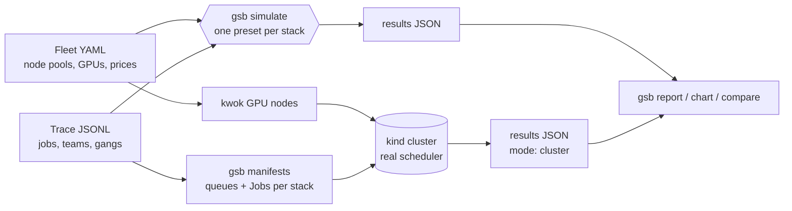

# k8s-gpu-scheduler-benchmark

[](https://github.com/sunilmehta-si/k8s-gpu-scheduler-benchmark/actions/workflows/ci.yml) [](https://github.com/sunilmehta-si/k8s-gpu-scheduler-benchmark/actions/workflows/cluster.yml)

**Which Kubernetes GPU scheduler should you run?** This project answers that with numbers. It replays the same AI
workload trace (multi-node training gangs, fine-tunes, inference services, notebooks) against each scheduling stack
and measures what platform teams argue about: GPU utilisation, fragmentation, queue wait, fairness between teams,
and cost. It does this two ways: a fast reference **simulation**, and **real schedulers** on a kind cluster with
simulated GPU nodes. **No GPUs are needed for either.**

Stacks: the default kube-scheduler, [Kueue](https://github.com/kubernetes-sigs/kueue),
[Volcano](https://github.com/volcano-sh/volcano) and [KAI Scheduler](https://github.com/kai-scheduler/KAI-Scheduler),
the scheduler at the core of the newly open-sourced [NVIDIA Run:ai](https://github.com/dsx-ai-factory/run-ai), each
as installed and, where it matters, configured to bin-pack GPUs.

## The finding: most schedulers don't bin-pack GPUs until you tell them to

Out of the box, only KAI Scheduler packs GPU pods by their GPUs. The default kube-scheduler and Kueue score nodes by
cpu and memory, so a GPU-only pod lands on any node that fits. Volcano's binpack packs the 100m cpu it charges a pod
without requests, so it stacks small pods on whichever node already has the most. One setting fixes each
([why, with sources, and the exact config](docs/gpu-scoring.md)).

The same 12-job trace on the **real schedulers** (two 8-GPU H100 nodes, four 4-GPU L40S nodes; kind + kwok in CI,
[results](results/cluster/README.md)):

| Real scheduler | Time to finish | Queue wait p95 | Cost per useful GPU-hour |
|---|---|---|---|
| default kube-scheduler | 7.8 h | 338 min | $5.25 |
| default + GPU `MostAllocated` profile | **7.3 h** | 149 min | $4.19 |
| Volcano v1.16.0 | 9.9 h | 391 min | $5.34 |
| Volcano + `binpack.resources: nvidia.com/gpu` | **7.3 h** | **80 min** | **$3.97** |
| Kueue v0.20.1 | 7.3 h | 100 min | $3.97 |
| Kueue + GPU `MostAllocated` profile | 7.3 h | 120 min | $3.97 |
| KAI Scheduler 0.18.5 | **7.3 h** | 81 min | **$3.97** |

What happened, from the recorded placements (`gsb timeline`):

- **Volcano as installed** put every notebook and inference pod on one H100 node until it was full. The 16-GPU training
  gang needs both H100 nodes, so it waited seven hours for those inference pods to end. Configured to score GPUs, it
  put them all on the L40S nodes: **26% faster and 26% cheaper per useful GPU-hour**.
- **The default scheduler** scattered small pods across H100 and L40S nodes alike, and the training gang started
  2.5 hours later than with GPU-aware placement. A second scheduler profile cut its cost per useful GPU-hour by 20%.
- **Kueue** gets most of the benefit from admitting whole workloads by quota; on this trace placement changed little.

At fleet scale, in simulation (256 GPUs, 131 jobs per trace, [ten traces](results/sweep-mixed-256-tuned.md)), the
saving is smaller but holds for every stack: GPU bin-packing lowers the mean cost per useful GPU-hour from $5.31 to
$5.21 for the default scheduler, $5.11 to $4.92 for Kueue and $5.12 to $4.92 for Volcano, which matches KAI's $4.92.

Three more things the numbers say:

- **Spreading GPU pods is what really hurts.** [`gsb ablate`](#quick-start) switches behaviours on one at a time. On the
  256-GPU sample trace, placing pods on the node with the most free GPUs takes 26.0 h; random placement and
  bin-packing both finish in 19.9 h. A scheduler that ignores GPUs is a lottery; one that spreads them is a loss.
- **Preemption protects interactive work, at a price.** On the 32-GPU lab ([full results](results/README.md)),
  every stack that preempts by priority keeps notebook waits at 0 min p95; Volcano's default doesn't preempt, and
  notebooks wait 31 min. KAI's reclaim cost 72 GPU-hours of training progress on the 256-GPU fleet, even with
  30-minute checkpoints.
- **At data-centre scale the stacks separate on waiting, not cost.** On the 1,024-GPU fleet (256 nodes, 611 jobs,
  [results](results/README.md)), every stack finishes in 23.5 h at $4.57 per useful GPU-hour. What differs is
  queue wait p95 (88 min with KAI, 124 with Kueue, 168 with the default scheduler, 184 with Volcano), the 130
  GPU-hours the default scheduler strands in half-placed gangs, and fragmentation: 1.9% of nodes partly used
  with KAI against 12% with the default scheduler and Kueue.

## Checked against the real schedulers

The [cluster workflow](.github/workflows/cluster.yml) installs each real scheduler on a kind cluster with
[kwok](https://kwok.sigs.k8s.io/) GPU nodes on every push, replays the trace, and compares the result with the model
job by job. Over 100 placement seeds, the model's median is within 4% of the real Volcano and inside the range of
the real default scheduler and Kueue; the stacks that pack GPUs are a consistent 6% slower on the real control plane
(7.3 h against 6.9 h), which is scheduling latency the model leaves out
([methodology](docs/methodology.md#how-close-is-the-model)).

The runs check themselves: each pod's runtime against its expected runtime, and the time from being bound to a node
to starting. Those checks caught two kwok settings that made results look plausible and wrong: a jitter value that
finished every pod instantly, and default pod-create and pod-ready delays that idled every pod's GPUs for 30 trace
minutes ([write-up](docs/cluster-runs.md#how-a-run-is-checked)). Comparing placements, not totals, is also what
showed the first Volcano model was wrong.

## Quick start

```bash
pip install git+https://github.com/sunilmehta-si/k8s-gpu-scheduler-benchmark
git clone https://github.com/sunilmehta-si/k8s-gpu-scheduler-benchmark && cd k8s-gpu-scheduler-benchmark

gsb trace generate --fleet fleets/mixed-256.yaml --hours 8 --rate 16 --seed 42 -o my-trace.jsonl
gsb simulate --fleet fleets/mixed-256.yaml --trace my-trace.jsonl -o results.json
gsb report results.json                                   # Markdown comparison
gsb chart results.json -o results.svg                     # bar charts
gsb sweep --fleet fleets/mixed-256.yaml --seeds 1-10      # mean and spread over ten traces
gsb sweep --fleet fleets/mixed-256.yaml --seeds 1-5 --rates 8,12,16,20   # load curve
gsb ablate --fleet fleets/mixed-256.yaml --trace my-trace.jsonl          # which behaviour causes a gain
gsb sweep --fleet fleets/mixed-256.yaml --seeds 1-10 --stacks volcano,volcano-binpack,kai  # as installed vs tuned
```

Bring your own fleet (node pools, GPU models, prices) and trace (one JSON object per job; jobs can require a GPU
model). See [`trace.py`](gpu_sched_bench/trace.py) and [`fleets/`](fleets).

### On a real cluster

Needs Docker, kind, kubectl and Helm ([guide](docs/cluster-runs.md)):

```bash
make cluster STACK=kai          # kind + kwok, install KAI, replay the smoke trace, compare with the model
make cluster STACK=volcano-binpack   # or any tuned variant: default-binpack, kueue-binpack
gsb timeline cluster-kai.json --stack kai   # which job held which node, and when
make versions                   # which pinned scheduler or tool has a newer release upstream
```

## How it works



`gsb simulate` is a discrete-event **model** of each stack's documented behaviour: gang or pod-by-pod placement,
spread or bin-packing, queue order, quotas, borrowing, reclaim and priority preemption. It is not the schedulers' code
and models no hardware effects. Every modelling choice and its source is in [docs/methodology.md](docs/methodology.md).
`gsb cluster run` measures the real scheduler with the same metrics code, so the two are directly comparable.

## Status

| Part | State |
|---|---|
| Fleets, traces, generator, GPU-model requirements | Done, tested |
| Reference simulator, seven presets (four stacks as installed, three tuned), metrics, reports, charts, sweeps, load curves, ablation | Done, tested; committed results reproduced in CI |
| Real-scheduler runs on kind + kwok for all seven, with runtime and start-lag checks and per-pod placements | Done, in CI on every push |
| Larger fleets: a 1,024-GPU data centre with a 611-job trace, next to the 256-GPU and 32-GPU fleets | Done, tested; committed results reproduced in CI |
| NVIDIA Run:ai full platform, DRA, topology-aware placement | Planned |

Contributions welcome: see [CONTRIBUTING.md](CONTRIBUTING.md).

## Related projects

Other open-source infrastructure work by [Sunil Mehta](https://github.com/sunilmehta-si):

- [agentic-code-review-tool](https://github.com/sunilmehta-si/agentic-code-review-tool): Scanner-grounded AI code review for the whole pull request: app, infrastructure and AI/agent code.
- [ai-devsecops-cicd](https://github.com/sunilmehta-si/ai-devsecops-cicd): Reference DevSecOps pipeline for LLM and AI-agent services: AI security tests, SBOM/AI-BOM, signing, admission policy.
- [llm-inference-platform](https://github.com/sunilmehta-si/llm-inference-platform): GPU-backed LLM serving with a streaming gateway, monitoring and reproducible benchmarks.
- [jev-inference-router](https://github.com/sunilmehta-si/jev-inference-router): Observable decision routing for local GPU inference, evaluated against rule-based and classifier baselines.

## License

[MIT](LICENSE) © Sunil Mehta
